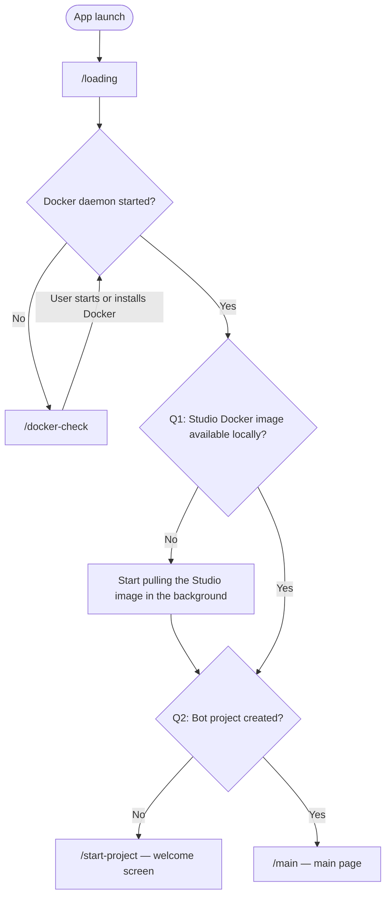

# Lugo Studio V3 — development process and navigation

This file is the source of truth for **startup navigation** and the **first development slice**. When a screen, gate, or backlog item changes, update this document in the same change.

Do not invent extra startup screens. Do not wait on the Studio image pull before continuing past Q1.

---

## How to work from this file

1. Implement backlog items in the order listed under [First things to develop](#first-things-to-develop), unless a later item is a hard dependency of an earlier one.
2. Wire real logic into the existing Electron split: **main** owns Docker, config, updates, logs, and notifications; **renderer** owns screens; **preload** is the only bridge (`window.studio`).
3. Replace dummy “Continue” buttons with the gates below. Do not add a second router.
4. After adding a route or changing a gate, update the [Route map](#route-map) and the flowchart in this file.
5. Keep settings compatible with previous Lugo Studio (V1). Do not introduce a new settings file format or location without a migration path.

---

## Startup navigation

Default entry is `#/loading` (`src/renderer/lib/router.js`).

### Gates

| Gate | Question | No | Yes |
| --- | --- | --- | --- |
| Docker started | Is the Docker daemon running? | Stay on `/docker-check` and ask the user to install or start Docker. Re-check until it is running. | Continue to Q1. |
| Q1 | Is the Studio Docker image available locally? | Start pulling it **in the background**. Do not block navigation. Continue to Q2. | Continue to Q2. |
| Q2 | Is the bot project created? Yes only when `{appData}/.LugoStudio/user.json` exists, `project_path` is an absolute path other than `.`, and `{project_path}/.lugo/info.json` exists. | Present the welcome screen (`/start-project`). | Go to the main page (`/main`). |

The image pull from Q1 may still be running on the welcome or main page. Progress belongs in the shell (status, notifications, and later the images page), not as a blocking startup screen.

### Docker daemon check

Main runs a fixed `docker info` (no user-supplied arguments, no shell). Timeout is **5 seconds** (`DOCKER_INFO_TIMEOUT_MS` in `src/main/services/docker/constants.js`). Exit 0 → `running: true`. Missing binary, non-zero exit, spawn error, or timeout → `running: false` (fail closed). After a check, `running` is always a boolean; it is never `null`. The renderer never spawns Docker — it only calls `window.studio.docker.status`.

`/docker-check` re-checks on **Re-check now** and polls about every 4 seconds while the page is visible. When `running` is `true`, it calls `continueAfterDocker()` in `src/renderer/lib/continue-after-docker.js`. Until step 05 wires loading → Q1 → Q2, that helper navigates to `/start-project` as a **temporary** stand-in. Step 05 should change the helper, not the docker-check page.

Tests: `npm run test:docker`.

### Q1 Studio image

Studio image is **`lugobots/studio:latest`** (`STUDIO_IMAGE_REF` in `src/main/services/docker/constants.js`). When the daemon is up, main lists local images with a fixed `docker images` command. If that repository and tag are missing, it starts `docker pull lugobots/studio:latest` in the background and returns immediately — navigation must not wait for the pull. If the daemon is down, Q1 does not start a pull.

Progress is coarse states (`idle`, `pulling`, `ready`, `error`) plus percent/bytes when the CLI output is cheap to parse. Events must not include layer payloads. The image reference is a constant, not renderer-supplied; the renderer never talks to the Docker socket (`window.studio.docker.imageStatus`, `ensureImage`, `onImageProgress`). Notifications are still a stub: pull failures are logged in main and stored as `error` on image status until step 06.

`ensureStudioImage()` is fire-and-forget from the caller’s point of view (it may wait on a short `docker images` lookup, never on pull completion). Step 05 should call it when wiring loading → Q1 → Q2; this slice does not change `continueAfterDocker()` navigation.

Tests: `npm run test:docker-images`.

---

## Route map

| Route | Screen | When it is shown | Status |
| --- | --- | --- | --- |
| `/loading` | Loading | Always first after launch. Short splash / bootstrap while the app prepares the next gate. | Dummy page exists |
| `/docker-check` | Docker check | Docker daemon is not running (or not installed). | Real gate (`docker info` via main) |
| `/start-project` | Welcome | Q2 is no: no bot project created yet. | Dummy page exists |
| `/main` | Main page | Q2 is yes: a bot project already exists. | **Not created yet** |
| `/settings` | Settings / preferences | User opens local settings from the shell. | **Not created yet** |
| `/images` | Images manager | User manages Studio (and related) image tags and pulls. | **Not created yet** |

Renderer registration lives in `src/renderer/app.js`. Page modules live under `src/renderer/pages/`.

---

## First things to develop

Build these before filling in bot-run / VS Code / publish flows. Check an item off here when it is done, and note the files that own it.

### 1. Upgrade checks

- Detect whether a newer Studio app version is available.
- Run this without blocking the navigation gates above (same idea as the image pull: check in the background, surface the result).
- Stub today: `src/main/services/updater/index.js` (`check()` always returns `{ available: false }`).
- Dev mock feed: `http://127.0.0.1:47821` via `npm run mock-update-server` (not wired to the updater stub yet).

### 2. Upgrade process

- Download and apply the app update once the user accepts it.
- Define cancel / retry / failure behavior using the dialog and notification format from item 4.
- Keep the updater in main (`src/main/services/updater/`). Do not download updates from the renderer.

### 3. Displaying version on the UI

- Show the running app version in the shell (footer or settings header at minimum).
- Source of truth is the app package version, not a hardcoded string in the renderer.
- Preload already exposes Electron/Node/Chrome versions on `window.studio.versions`; add the **Studio** version next to those.

### 4. Dialog and notification format

- One in-app dialog pattern (confirm, error, progress) and one notification pattern (OS and/or in-app toast).
- Use the same components for upgrades, Docker, image pulls, settings save, and debug log upload.
- Stub today: `src/main/services/notifications/index.js` and renderer has no dialog system yet.

### 5. Main layout and colors

- Replace the centered card shell with the real app chrome used after startup (sidebar/header/status as needed).
- Loading, Docker check, and welcome may stay simpler, but they must use the same color tokens.
- Tokens live in `src/renderer/styles/base.css`. Layout shell lives in `src/renderer/layout/shell.js`.
- Main page (`/main`) is the first screen that must use the full layout.

### 6. Settings persisting system

- **Done.** Main reads and writes V1’s `{appData}/.LugoStudio/user.json` (same path in development and packaged builds). See [V1-compatible settings](#v1-compatible-settings).
- Owner: `src/main/services/config/` (`get` / `set`). IPC: `src/main/ipc/config.js`. Renderer: `window.studio.config` only — no filesystem access.
- Q2 `projectCreated` is derived (never stored). `config.set` applies a partial patch to V1 keys and returns `{ error }` if the write fails.
- Tests: `npm run test:config`.

### 7. Page to update settings / preferences locally

- Route: `/settings`.
- Edit the persisted preferences from item 6 (paths, optional VS Code Web, notification/debug options, and so on).
- Saving must go through `window.studio.config`, never through renderer filesystem access.

### 8. Images manage page

- Route: `/images`.
- Define the image **name + tag** used in the background (Studio image first; add others only when a feature needs them).
- List local availability, pull, and show pull progress.
- Q1 uses this same definition: “available locally” means `lugobots/studio:latest` is listed by `docker images`.
- Record the chosen tags in this file once they are decided (see [Open decisions](#open-decisions)). Q1’s Studio image is decided; other images on this page remain TBD.

### 9. Debugging control

- Write app logs to a file (main process owns the file).
- Provide a manual action to send those logs to the Lugo backend for support.
- Surface success/failure with the notification format from item 4.
- Do not send logs automatically in this slice; upload is user-triggered only.

---

## Open decisions

Fill these in before the matching backlog item is considered done.

| Topic | Decision |
| --- | --- |
| Studio Docker image name and tag used at Q1 | `lugobots/studio:latest` (placeholder; constant `STUDIO_IMAGE_REF` in `src/main/services/docker/constants.js`). |
| Docker daemon check | Fixed `docker info` with a 5s timeout; fail closed to `running: false`. |
| Other images/tags managed on `/images` | _TBD_ |
| V1 settings path and format | Always `{app.getPath("appData")}/.LugoStudio/user.json` (not Electron `userData`, not the git working tree). UTF-8 JSON, two-space indent, full V1 `UserData` key set. Details: [V1-compatible settings](#v1-compatible-settings). |
| App update feed / provider | Dev mock JSON at `http://127.0.0.1:47821` (`mock-update-server/`). Production host TBD. |
| Debug log upload endpoint | _TBD_ |

---

## V1-compatible settings

V3 always uses the **production** V1 path, in both development and packaged builds. It does **not** use V1’s development-mode override that stored `.LugoStudio` next to the git working tree.

| OS | Folder |
| --- | --- |
| Windows | `%APPDATA%\.LugoStudio\` |
| macOS | `~/Library/Application Support/.LugoStudio/` |
| Linux | `$XDG_CONFIG_HOME/.LugoStudio/` or `~/.config/.LugoStudio/` |

File: `user.json`, UTF-8, pretty-printed JSON (two-space indent, same as V1).

`install_unique_id` on first create uses `node-machine-id` `machineIdSync(true)`, matching V1. Existing V1 files keep their id. If that library fails, a generated UUID is used instead (that first-create id would not match V1).

`projectCreated` is derived for IPC (`config.get()` / `config.set()` return it plus `projectPath`). It is never a JSON key. `projectPath` is the stored `project_path` when Q2 is yes, otherwise `null`. Renderer-friendly patch names (`projectPath`, `debugMode`, …) map to snake_case storage. Unknown extra keys are preserved. Write failures return `{ error }` on `config.set` (for step 08 dialogs) and do not throw.

Round-trip these keys (types and V1 defaults):

| Key | Role | Default when creating a new file |
| --- | --- | --- |
| `install_unique_id` | Stable install id | `node-machine-id` `machineIdSync(true)` |
| `debug_mode` | Verbose / debug | `false` |
| `project_path` | Absolute bot root | `"."` until a project is opened |
| `team_side` | `home` or `away` | `home` |
| `opponent_team` | Opponent id | `level-0` |
| `game_speed` | 1 / 2 / 3 | `1` |
| `saved_positions` | Array of saved formations | `[]` |
| `compose_file` | Absolute compose path | `""` |
| `game_server_image` | Image name | `lugobots/server` |
| `game_server_version` | Tag | `v2` |
| `bot_level_0_image` | | `lugobots/level-0` |
| `bot_level_0_version` | | `v2` |
| `bot_level_1_image` | | `lugobots/level-1` |
| `bot_level_1_version` | | `v4` |
| `app_path` | Electron app path at last write | `"."` until opened |
| `app_version` | Last-seen Studio version | Current `app.getVersion()` on load/save |

On successful load, in-memory `app_version` is set to the running app version. That refresh is persisted on the next save, not on every launch.

---

## Current code map

| Concern | Location |
| --- | --- |
| Mock update HTTP server (dev) | `mock-update-server/` |
| App lifecycle | `src/main/main.js` |
| Window | `src/main/windows/app-window.js` |
| IPC registration | `src/main/ipc/` |
| Docker / config / updater / notifications / media | `src/main/services/` |
| Preload bridge | `src/preload/preload.js`, `src/preload/api.d.ts` |
| Channel names | `src/shared/ipc-channels.js` |
| Router | `src/renderer/lib/router.js` |
| Docker daemon check | `src/main/services/docker/status.js` (`docker info`, 5s timeout). Tests: `npm run test:docker` |
| Q1 Studio image | `src/main/services/docker/images.js` (`lugobots/studio:latest`, background `docker pull`). Tests: `npm run test:docker-images` |
| Continue after Docker (interim) | `src/renderer/lib/continue-after-docker.js` — currently `#/start-project` until step 05 |
| Dummy pages | `src/renderer/pages/loading`, `start-project` |
