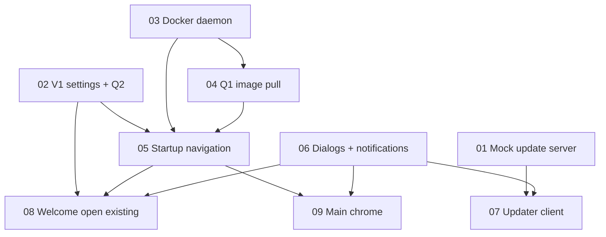

# Startup fundamentals — mock updates, gates, welcome, and main

## Overview

Stand up the first usable slice of Lugo Studio V3: a local mock update server, V1-compatible local settings, real startup navigation through Docker and project detection, and the screens up to the welcome page and the main chrome. Technical outcome is an Electron app that, on launch, checks Docker, starts a background Studio image pull if needed, then either opens an existing bot or shows welcome — while a separate Node process can advertise and serve a newer app binary for download-only testing. This plan lives in `studio-v3` only; V1 (`studio`) is the compatibility reference, not a target for changes.

## Status

| Step | Title | Status | Owner | Depends on | Notes |
|------|-------|--------|-------|------------|-------|
| [01](step-01-mock-update-server.md) | Mock update HTTP server | `done` | — | — | Custom JSON; drop folder for binaries. [#1](https://github.com/lugobots/studio-v3/pull/1) |
| [02](step-02-v1-compatible-settings.md) | V1-compatible settings + Q2 detection | `done` | — | — | Same `user.json` path and schema. PR pending. |
| [03](step-03-docker-daemon-gate.md) | Docker daemon gate | `pending` | — | — | Replaces dummy `/docker-check` |
| [04](step-04-q1-image-pull.md) | Q1 image check + background pull | `pending` | — | 03 | Placeholder `lugobots/studio:latest` |
| [05](step-05-startup-navigation.md) | Wire startup navigation | `pending` | — | 02, 03, 04 | Replace dummy Continue buttons |
| [06](step-06-dialog-notification.md) | Dialog + notification pattern | `pending` | — | — | Shared by updates and open-bot errors |
| [07](step-07-updater-client.md) | Version UI + check + download | `pending` | — | 01, 06 | Download only; no quit-and-install |
| [08](step-08-welcome-open-existing.md) | Welcome — open existing bot | `pending` | — | 02, 05, 06 | Create-new-bot deferred |
| [09](step-09-main-page-chrome.md) | Main page chrome + placeholder | `pending` | — | 05, 06 | Full layout; no game run |

Valid statuses: `pending` | `in-progress` | `done` | `blocked` | `deferred` | `cancelled`

## Current focus

Step 03 — pending. Steps 03 and 06 can start in parallel; 04 waits on 03; 05 waits on 03–04.

## Dependency graph

## Decisions log

1. **Full plan** — Multi-step handoff with a master README; not a single `plan.md`.
2. **Custom JSON update protocol** — V3 does not speak electron-updater YAML in this slice. The mock exposes a version-check endpoint and a file download. Production feed host remains TBD.
3. **Mock location** — Inside `studio-v3` as a separate Node process (`mock-update-server/`), not a sibling repo and not inside the Electron main process.
4. **Q2 gate** — Welcome vs main is yes only when `{appData}/.LugoStudio/user.json` exists **and** `project_path` is a valid bot (`{project_path}/.lugo/info.json` exists). Invalid or missing bot folder goes to welcome even if `user.json` is present. This is stricter than V1 Home, which only checked `user.json`.
5. **Welcome depth** — Open an existing bot (folder picker + validity check), persist V1-compatible settings, navigate to `/main`. Create-new-bot (language + empty folder + setup image) is out of scope.
6. **Main depth** — Real app chrome (sidebar, header, status). Show project path and app version. Placeholder body. No player controls, game iframe, VS Code, or publish.
7. **Update apply** — Check in the background, notify, download on accept into `{appData}/.LugoStudio/updates/`. Do not quit-and-install.
8. **Q1 image** — Placeholder name and tag `lugobots/studio:latest`. If missing locally, start a background pull and continue to Q2. Do not block on the pull.
9. **Settings path** — Always `{app.getPath("appData")}/.LugoStudio/user.json` (Windows: `%APPDATA%\.LugoStudio\user.json`). Do not use V1’s development-mode project-root `.LugoStudio` folder, so a real V1 install is visible to V3 in dev.
10. **Mock bind and port** — Listen on `127.0.0.1:47821` only.
11. **Binary naming** — Drop files named `Lugo-Studio-{Windows|Mac|Linux}-{version}.{ext}` into `mock-update-server/releases/`.
12. **Downloaded artifacts** — Store accepted downloads under `{appData}/.LugoStudio/updates/`.
13. **Open-existing write** — Preserve every existing `user.json` key. Set `project_path`, set `compose_file` to `{folder}/docker-compose.yml`, refresh `app_path` and `app_version`. Do not write `.studio.env` in this slice.
14. **Plan location** — `studio-v3/docs/startup-fundamentals/`.

## Assumptions to verify

- Electron `app.getPath("appData")` on Windows, macOS, and Linux matches V1’s `.LugoStudio` parent (same as V1 `PathManager` production path). Verify in step 02.
- `docker info` (or equivalent daemon ping) is a reliable “Docker started?” signal on the developer’s machine, including Docker Desktop still booting. Verify in step 03.
- `lugobots/studio:latest` exists on Docker Hub (or the configured registry) so a background pull can succeed. If the tag 404s, Q1 still must not block navigation; surface failure in status/notifications. Verify in step 04.
- Semver in drop-file names is comparable to `package.json` `version` (`0.1.0` today). Verify in steps 01 and 07.
- Folder picker plus `.lugo/info.json` is enough to treat a V1 bot as openable; modern bots keep `docker-compose.yml` at the project root. Legacy `.studio/` compose clones are not rewritten in this slice. Verify in step 08.
- A short loading splash can finish Docker + config + image-presence checks without feeling stuck. Verify in step 05.

## Out of scope

- `/settings` page — DEVELOPMENT.md item 7; settings **read/write** is in step 02, the editor UI is later.
- `/images` manager page — DEVELOPMENT.md item 8; Q1 uses the same image definition but no dedicated page.
- Create a new bot (language select, empty folder, `lugobots/bot-setup`) — follow-up after welcome.
- Quit-and-install / electron-updater generic YAML feed / production `https://lugobots.ai/api/studio/check-update` host — later when packaging exists.
- Debug log file + upload to Lugo backend — DEVELOPMENT.md item 9.
- Game server start/stop, player/opponent controls, game iframe, saved formations, publish, VS Code Web.
- Writing `.studio.env` or running compose.
- Theme `localStorage` key from V1 (`lugo-studio-theme`) — not required for this slice.
- Changing V1 (`studio`) source.

## Notes

- Product navigation source of truth remains [DEVELOPMENT.md](../../DEVELOPMENT.md). Implementers must update its route map, flowchart, open-decisions table, and “first things to develop” checkboxes in the same change that lands the behavior.
- Do not add a second router. Hash routes stay in `src/renderer/lib/router.js`. Main owns Docker, config, updates, logs, and notifications; renderer owns screens; preload is the only bridge (`window.studio`).
- V1 `UserData` keys that V3 must round-trip (read and write without dropping): `install_unique_id`, `debug_mode`, `project_path`, `team_side`, `opponent_team`, `game_speed`, `saved_positions`, `compose_file`, `game_server_image`, `game_server_version`, `bot_level_0_image`, `bot_level_0_version`, `bot_level_1_image`, `bot_level_1_version`, `app_path`, `app_version`. `projectCreated` is a **derived** IPC flag, not a stored key.
- V1 bot validity: folder must contain `.lugo` and `.lugo/info.json` (`checkIfBotIsValid` in V1 `electron/utils/bot.ts`).
- Recommended first implementation step: [01 — Mock update HTTP server](step-01-mock-update-server.md) if working alone on updates, or [02 — V1-compatible settings](step-02-v1-compatible-settings.md) if working alone on navigation. Parallelize 01, 02, 03, and 06 when more than one person is available.
