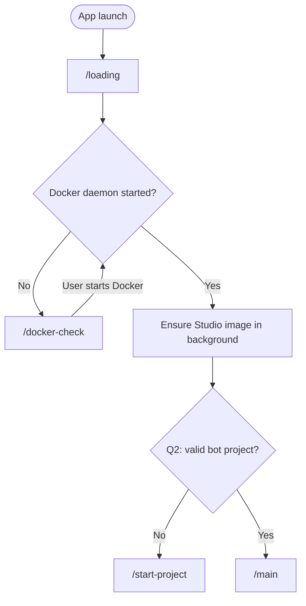

# Step 05 — Wire startup navigation

**Phase:** Startup gates
**Status:** `done`
**Depends on:** [Step 02](step-02-v1-compatible-settings.md), [Step 03](step-03-docker-daemon-gate.md), [Step 04](step-04-q1-image-pull.md)
**Unblocks:** [Step 08](step-08-welcome-open-existing.md), [Step 09](step-09-main-page-chrome.md)
**Plan index:** [README](README.md)

## Summary

Replace dummy Continue buttons with the DEVELOPMENT.md flowchart: launch always hits `/loading`, then Docker, then non-blocking Q1, then Q2 to `/start-project` or `/main`. Register `/main` even if the page is still a thin placeholder until step 09.

## Context

Today `/loading` and `/docker-check` always navigate forward on click, and `/start-project` is a dead end. Gates Q1 and Q2 are documentation only. This step is the integration of services from 02–04 into one navigation owner so later pages do not each reimplement the flowchart.

## Scope

**In scope**
- A single startup sequencer in the renderer (or a small module under `src/renderer/lib/`) that pages call; no second router.
- `/loading` auto-runs the sequencer after a short splash (no dummy button).
- `/docker-check` is only shown when the daemon is not running; success resumes the sequencer.
- After Docker is up: invoke Q1 ensure-image (fire-and-forget), then Q2 via `config.get()`.
- Q2 no → `#/start-project`. Q2 yes → `#/main`.
- Register `/main` in `src/renderer/app.js` (placeholder module allowed until step 09).
- Update the DEVELOPMENT.md route map statuses: loading and docker-check are no longer dummy; `/main` exists (even if chrome is incomplete).

**Out of scope**
- Welcome open-existing actions (step 08) beyond being the Q2-no destination.
- Full main chrome (step 09).
- Update check (step 07) — may start in parallel from loading or main `did-finish` in main process; must not alter gate order.
- Deep links to `/settings` or `/images`.

## Requirements

### Flow (must match DEVELOPMENT.md)

### Loading

- Default hash remains `#/loading`.
- Show the existing splash tokens; then run checks. If Docker is already up, do not flash docker-check.
- If checks throw, stay on loading or docker-check with an error line; do not send the user to `/main` with unknown state.

### Docker resume

- When docker-check observes `running: true`, continue the same sequencer (Q1 then Q2), not a hardcoded jump to welcome.

### Q1

- Do not add a `/pull` route. Do not wait for pull completion.

### Q2

- Use step 02’s `projectCreated` only. Do not re-implement `.lugo/info.json` in the renderer.

### Back/forward

- Hash history: if the user manually opens `#/main` without Q2, redirect through the sequencer or send them to welcome. If they open `#/start-project` while Q2 is yes, send them to `/main` (studio is already set up). Document this in DEVELOPMENT.md.

## Technical direction

- `src/renderer/lib/` sequencer module used by loading and docker-check.
- `src/renderer/app.js` — register `/main`.
- `src/renderer/pages/loading/index.js` — remove dummy Continue.
- `src/renderer/pages/docker-check/index.js` — resume sequencer on success (step 03 page + this integration).
- `src/renderer/pages/main/index.js` — stub page until step 09 if needed.
- Do not move gate logic into Electron `main.js` beyond the services already exposed.

## Security & compliance

- Sequencer only calls existing `window.studio` APIs. No extra privileges.

## Acceptance criteria

- [x] Cold start with Docker down lands on `/docker-check` without a click.
- [x] Cold start with Docker up and no valid project lands on `/start-project` without a click.
- [x] Cold start with Docker up and valid V1 `user.json` + `.lugo/info.json` lands on `/main` without a click.
- [x] Image pull, if started, does not delay the welcome/main transition.
- [x] Dummy Continue buttons are gone from loading and docker-check.
- [x] DEVELOPMENT.md flowchart and route map match the running app.

## Verification

- Manual: three cold starts covering the acceptance rows above.
- Manual: from docker-check, start Docker, confirm resume to welcome or main based on Q2.
- Manual: set hash to `#/main` with no project; confirm redirect to welcome.

## Risks & edge cases

- Race: config get vs user deleting the bot folder during loading — accept the snapshot at check time; next launch re-evaluates.
- Splash too fast to read — keep a minimum display time on the order of a few hundred milliseconds if the checks finish instantly; do not add multi-second fake delay.
- Step 09 not done: `/main` may look like a card; that is OK if the route exists.

## Follow-ups

- Welcome CTAs (step 08).
- Main chrome (step 09).
- After open-existing, navigate to `/main` without a full app restart (step 08).

## Landed

- Sequencer in `src/renderer/lib/startup-sequencer.mjs`. Loading auto-runs it (~400ms splash). Dummy Continue is gone.
- `continueAfterDocker()` resumes Q1 then Q2. `/main` is registered as a placeholder card.
- Hash guards: `#/main` without Q2 → welcome; `#/start-project` with Q2 yes → `/main`.
- Tests: `npm run test:startup` (44 passed). Electron cold-start click-through was not run in this PR.
- Deviations: sequencer is `.mjs` for Node 18; `#/main` without Q2 goes to welcome rather than a full sequencer re-run.
- PR: pending.
